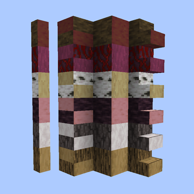

# Log Stairs, Slabs and Walls



[English](README.md)

原木の階段・ハーフブロック・塀・パネル。樹皮は 1 面ずつ剥げます。

バニラのすべての木に、原木の見た目の階段・ハーフブロック・塀と、フルブロックの原木パネルを追加する Minecraft の MOD です。
斧でクリックした面だけ樹皮が剥がれるので、厚さ 1 ブロックの壁や屋根でも「外は樹皮、内は木肌」のように表と裏の見た目を変えられます。

> **ダウンロード:** [GitHub Releases](https://github.com/nokopi36/LogStairsSlabsAndWalls/releases)。対応バージョンは[変更履歴](CHANGELOG.md)を見てください。
>
> 姉妹 MOD: [Log Fences and Gates](https://www.curseforge.com/minecraft/mc-mods/log-fences-and-gates)（部位ごとに樹皮を剥げる原木のフェンス・フェンスゲート）

## 機能

- **原木パネル・階段・ハーフブロック・塀**を 13 種類の木に追加: オーク、トウヒ、シラカバ、ジャングル、アカシア、ダークオーク、マングローブ、サクラ、ペールオーク、ポプラ、竹ブロック、真紅の幹、歪んだ幹
  - 原木パネルはフルブロックで、バニラの原木と同じく縦にも横にも置けます。その木の原木として扱われるので、1 個で板材にクラフトできます。
  - 階段・ハーフ・塀は縦置きの原木の見た目です（上下は年輪、横は樹皮）。バニラの同じ形のブロックと同じように繋がり・重なり、塀はバニラの塀とも繋がります。
- **面ごとの樹皮剥ぎ。** 斧を持って右クリックすると、クリックした面だけ樹皮が剥がれます。方角はワールドの向きで、同じ向きの面はまとめて剥がれます。
  - 原木パネル: 6 面
  - 階段: 8 面。下の段の踏み面と上の段の蹴上げは外周の面と別なので、段ごとに見た目を変えられます。
  - ハーフブロック: 6 面。2 枚重ねでは上下のハーフが別々の状態を持つので、樹皮付きのハーフの上に剥いだハーフを重ねられます。
  - 塀: 6 方向（柱と壁はまとめて）
  - 剥がれ済みの面をクリックしても何も起きず、斧も消耗しません。
- **剥いだ版。** 樹皮を剥いだ原木（または剥いだ原木パネル）からクラフトすると、置いた時点で全面が剥がれたブロックが手に入ります。
  全面が剥がれたものを壊すと剥いだ版が、一部だけ剥がれたものを壊すと普通の版がドロップします。2 枚重ねのハーフは上下のハーフごとにドロップします。
- ストラクチャー（ストラクチャーブロック、`/place template`）を回転・反転して置くと、剥いだ面もブロックと一緒に回ります。
- 性能はバニラの原木と同じです: 硬さ 2.0、原木の音、斧で速く壊せる。真紅・歪んだ幹はバニラと同じく燃えません。パネル・階段・塀は燃料として 300 tick、ハーフは 150 tick 燃えます。
- バニラの原木のテクスチャを使うので、リソースパックにも対応します。

## レシピ

| 完成品 | レシピ |
|---|---|
| 原木パネル ×2 | 原木を縦に 2 個（インベントリの 2×2 でも作れる） |
| 原木 ×2 | 原木パネルを縦に 2 個 |
| 原木の階段 ×16 | 原木または原木パネル 6 個を階段の形に |
| 原木のハーフブロック ×24 | 原木または原木パネル 3 個を横一列に |
| 原木の塀 ×24 | `L L L` / `L L L`（L = 原木または原木パネル） |
| 竹ブロックの階段 ×8／ハーフ ×12／塀 ×12 | 竹ブロックで同じ形 |
| 剥いだ版 | 樹皮を剥いだ原木または剥いだ原木パネルで同じ形 |

原木と原木パネルは混ぜて使えます。個数はバニラの板材のレシピに合わせています（原木 1 個 = 板材 4 枚、竹ブロック 1 個 = 板材 2 枚）。塀はバニラの石の塀のレシピ（6 → 6）を同じように換算しています。

## 動作環境

- NeoForge。各リリースが対応する Minecraft と NeoForge のバージョンは[変更履歴](CHANGELOG.md)を見てください。
- クライアントとサーバーの両方に必要です。

## ビルド

```sh
./gradlew build
```

jar は `build/libs/logstairsslabsandwalls-neoforge-<Minecraft のバージョン>-<MOD のバージョン>.jar` に出力されます。Java 25 は Gradle の toolchain が自動でダウンロードします。

そのほかのタスク:

- `./gradlew runClient` — 開発用のクライアントを起動する
- `./gradlew runData` — モデル・言語ファイル・タグ・ルートテーブル・レシピを `src/generated/` に出力し直す
- `./gradlew runGameTestServer` — GameTest を実行する

## ライセンス

[MIT](LICENSE)
